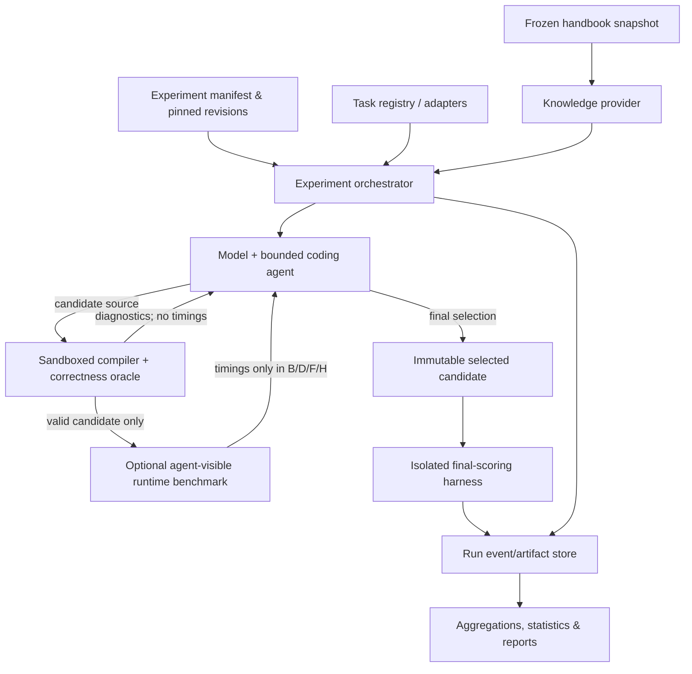

# Architecture specification

**Project:** SIMD Knowledge Bench  
**Status:** Proposed architecture; not implemented  
**Revision date:** 2026-11-03  
**Companion:** [Open design decisions](open-design-decisions.md)  
**Requirements:** [Experimental design](experiment-design.md) · [Evaluation protocol](evaluation-protocol.md) · [Retrieval design](retrieval-design.md)

## 1. Purpose and scope

Build a **local-first, reproducible experiment framework** to determine whether architectural knowledge improves an AI coding agent's ability to produce **correct and faster C/C++ SIMD-oriented code**. The first intended model is Qwen3.8-Flash-Next, but model backends must be replaceable.

The framework must support the original four experimental conditions and a later retrieval extension:

| Arm | Knowledge delivery | Candidate runtime feedback |
| --- | --- | --- |
| A | None | No |
| B | None | Yes |
| C | Full handbook | No |
| D | Full handbook | Yes |
| E | Basic RAG | No |
| F | Basic RAG | Yes |
| G | Hybrid diagnosis-guided RAG | No |
| H | Hybrid diagnosis-guided RAG | Yes |

**Runtime feedback** means *timing results shown to the agent while developing its solution*. Independent final performance evaluation occurs for **all** arms. Correctness and compilation feedback are available to every arm.

### In scope

- Import, normalize and pin benchmark tasks from external datasets.
- Generate candidate C/C++ implementations using a versioned model and agent policy.
- Provide zero, full-document, retrieved or hybrid knowledge according to the assigned arm.
- Compile and correctness-test every candidate in a constrained local execution environment.
- Optionally feed permitted performance measurements into the agent loop.
- Select and freeze a final candidate independently of the hidden scoring harness.
- Benchmark final candidates on a pinned target machine and aggregate valid results.
- Capture all inputs, outputs, intermediate actions and versions needed to reproduce each run.

### Out of scope for initial implementation

- Training or fine-tuning models.
- Building a general-purpose cloud CI/agent platform.
- Automatic repository-event-triggered GitHub Actions.
- Proving globally optimal SIMD implementations.
- Cross-hardware performance comparisons presented as if directly equivalent.
- Inferring that a code change is “architecturally better” from intrinsic usage alone.

## 2. Architectural principles and invariants

1. **Experiment policy before implementation:** arm configuration controls which knowledge and tools exist; the agent must not be able to bypass this by calling a lower-level service.
2. **Correctness before timing:** an implementation is never accepted as a performance improvement without passing its specified oracle.
3. **No hidden-score leakage:** agent-visible validation/measurement data and final hidden scoring inputs/results are separate trust domains.
4. **Reproducible inputs:** immutable task source, prompt, handbook, retriever index, model revision, compiler settings, CPU environment and seeds are recorded for each run.
5. **Immutable candidates:** a candidate has a content hash; compilation and scoring operate on frozen copies, not agent-editable paths.
6. **Append-only provenance:** retain failed attempts, retrievals, tests, selection decisions and timing repetitions. Reports can be regenerated from artifacts.
7. **Local execution first:** no GitHub Actions usage is needed to build, test or run experiments.
8. **Research design is configurable:** do not hard-code the number of candidates, benchmark datasets, ISA, retriever or model into components.
9. **Measure the complete transformation:** if repacking, setup, dispatch or scratch initialization are necessary for the optimized algorithm, include them in runtime scoring unless the task's contract explicitly excludes them.

## 3. System context



The diagram shows the logical control flow; **the orchestrator, not the model, owns access permissions and routing**. The scorer is invoked only after selection is frozen. Its results never reenter the agent's development context.

## 4. Components and responsibilities

| Component | Responsibility | Explicitly must not do |
| --- | --- | --- |
| **Task registry & adapters** | Import versioned upstream kernels; expose source, contract, task metadata, hidden oracle and size regimes | Leak hidden tests or optimized reference solutions to the agent |
| **Experiment orchestrator** | Expand a study into task × arm × seed jobs; enforce budgets; coordinate retries, selection and provenance | Modify prompt/tool policies after seeing held-out results |
| **Agent/model adapter** | Convert a normalized task into candidate revisions through a pinned model endpoint; log messages/token use | Directly invoke unrestricted local processes or inspect hidden scoring data |
| **Knowledge provider** | Serve none, full handbook, indexed sections or hybrid diagnosis-guided context; log retrieval | Index solutions, gold benchmark answers, hidden labels or final results |
| **Candidate validator** | Compile, run correctness oracle and report sanitized compile/test feedback | Expose elapsed times in no-runtime-feedback arms |
| **Feedback benchmark** | Return controlled candidate timing observations in B/D/F/H only | Use final-scoring input sets or exceed the per-run feedback budget |
| **Final scorer** | Independently measure frozen, valid selected code across predeclared regimes | Allow agent revisions or send scores to the model |
| **Artifact/event store** | Preserve immutable sources, binary hashes, run manifests, prompts, traces, raw timings and errors | Silently overwrite completed experiment evidence |
| **Aggregator/reporter** | Compute per-task correctness, speedups, cost, confidence intervals and task-family breakdowns | Treat failed candidates as if they were missing observations |

Components can initially be Python modules and CLI processes; the boundaries matter more than their deployment topology. The concrete implementation language and local storage technology remain [open decisions](open-design-decisions.md).

## 5. Trust and visibility boundaries

### Agent-visible workspace

Only a **sanitized task package** may reach the model:

- semantic contract and provided starter code;
- permitted editable files and public input examples;
- visible compiler/test feedback and diagnostics;
- knowledge material authorized by the arm;
- runtime feedback **only** if the arm permits it.

The model has no direct filesystem route to hidden scoring inputs, benchmark labels, gold transformations, oracle source when sensitive, grader credentials, arbitrary network access, or the final scorer.

### Evaluator-only material

The private evaluator owns hidden correctness cases, hidden performance input distributions, reference/gold metadata and final timing logs. Access controls are enforced through process/container boundaries and explicit APIs, not by prompt instructions.

### Generated code execution

Treat generated C/C++ as untrusted native code. Execute it with minimal privileges, restricted filesystem, no network, CPU/memory/time limits and no repository credentials. Use sanitized diagnostics and separate builds for correctness (including sanitizers where practical) and timing. The precise sandbox runtime remains open.

### Timing-channel restriction

“No runtime feedback” must mean that *all agent-observable* response payloads are stripped of elapsed-time data—not just that a benchmark tool is hidden. Avoid test-output timestamps, execution-duration metadata, timing-dependent diagnostic fields and profiling tools in A/C/E/G. Control the compile/test tool API consistently across arms; latency of tool calls themselves may remain a residual side channel and should be documented.

## 6. Data contracts (conceptual)

The following are **logical schemas**, not finalized serialization formats. Formal JSON Schema/Pydantic/protobuf choices are open.

### TaskDefinition

| Field | Meaning |
| --- | --- |
| `task_id`, `family_id` | Stable identity and correlated-kernel grouping |
| `source` | Dataset URL, immutable upstream commit/hash, path, license |
| `language`, `target_isa`, `compiler_profile` | Execution constraints |
| `problem_statement`, `starter_files`, `editable_paths` | Agent-visible package |
| `semantic_contract`, `numerical_policy` | Correctness semantics and acceptable error |
| `visible_tests`, `oracle_id` | Public test references and evaluator-only oracle identifier |
| `input_regimes`, `limits`, `split`, `tags` | Hidden/visible regime metadata, limits, grouping and task classification |

### StudyManifest

Specifies task list/split, arm assignments, generation seeds, model/checkpoint and inference parameters, handbook commit, retrieval version, compiler and hardware profiles, candidate/tool budgets, selection policy, timing methodology and primary metrics. Calculate a **study fingerprint** from canonicalized config and version identifiers.

### CandidateRecord

Contains immutable candidate source hash, parent candidate index, generation output/metadata, compile status, correctness status, sanitized feedback, allowed runtime-feedback observations, artifact references and terminal eligibility.

### RunRecord / events

The primary run key is `(study_id, task_id, arm, seed, trial)`. Events include:

```text
run_started
prompt_constructed
knowledge_requested / knowledge_delivered
candidate_generated
compile_completed
correctness_completed
feedback_benchmark_completed   # feedback arms only
candidate_selected
selection_frozen
final_scoring_completed
run_completed / run_failed
```

Each event records timestamp, monotonic sequence number, tool/policy version and artifact hashes. Store large payloads (prompts, source, binaries, logs, timing samples) separately under content-addressed paths.

**Selected candidate** and **reported best observed candidate** must be distinct fields. The latter is only valid where observations exist.

## 7. End-to-end execution lifecycle

1. **Prepare a study:** pin benchmark sources, handbook, model, compiler and harness; validate arm policies and task eligibility; register task families/splits.
2. **Instantiate run:** isolate a fresh workspace; derive the deterministic seed and resource budget; freeze the run manifest.
3. **Construct context:** supply the same baseline task/prompt contract across arms; inject nothing, the full book, or retrieved material according to the assigned policy.
4. **Generate candidate:** store raw messages and source; allocate a candidate hash.
5. **Validate:** compile and run oracle. If invalid, return sanitized failures and permit revision while budget remains.
6. **Provide optional runtime feedback:** for eligible valid candidates, measure only within the feedback harness and only in B/D/F/H, respecting a fixed measurement budget.
7. **Repeat or stop:** all arms follow the same predeclared candidate/iteration caps; preserve attempts and evidence.
8. **Select:** apply the arm's predeclared selection rule using only permitted observations; freeze the chosen source and compiler inputs.
9. **Score:** recompile/revalidate as needed; measure the frozen selection on independent final inputs, with repeated and randomized/interleaved timing.
10. **Aggregate:** compute per-task/arm metrics, uncertainty, regressions, retrieval diagnostics and token/latency costs from saved artifacts.

Do not silently substitute “best hidden-timing candidate” for a no-feedback arm's selected artifact.

## 8. Knowledge access implementations

**None:** no handbook text or retrieval tool; baseline system prompt is shared.

**Full:** inject a single canonical snapshot of the 24-chapter handbook, preserving headings and caveats. Record token count and any prompt-prefix cache utilization.

**Basic RAG:** parse canonical `book/*.md` into heading-aware sections. Query from sanitized code/task information; rank and return fixed-budget sections, retaining neighboring assumptions/caveats and section IDs.

**Hybrid RAG:** a fixed short conceptual scaffold prompts an architecture diagnosis (logical axes, dependencies, memory accesses, stationary data, lane mapping) before retrieval. Later retrieval can respond to *agent-visible* failures or timing observations where allowed.

**Oracle RAG:** a **separate ablation**, driven by evaluator-selected relevant sections and never allowed to leak solution implementations.

Store the query, rank, scores, retrieved hashes and exact delivered text for reproducibility. Prefer simple and transparent retrieval first; index and reranker technology remain open.

## 9. Execution and measurement requirements

- Pin the native target CPU, ISA, compiler/flags and harness; comparisons of arm outcomes are made **within the same hardware/measurement profile**.
- Run a trusted reference and frozen candidate on the same semantic inputs; use comparable compilation settings.
- Prevent dead-code elimination, measure repeated runs and record distributions, not only minimum time.
- Keep correctness and timed binaries/configurations separate.
- Use independent final scoring inputs (and preferably size regimes) not used for iterative tuning.
- Support timing of whole-pipeline work, including layout conversion where required.
- Publish success-conditioned speedup **alongside** all-task correctness and correct-and-faster rates. Do not silently omit invalid attempts from claims.
- Aggregate correlated size variants within semantic task family before cross-task inference.

Exact warmup counts, minimum durations, statistical stopping rules and reference baselines are open decisions; see [Evaluation protocol](evaluation-protocol.md).

## 10. Proposed repository structure

```text
docs/
  architecture-specification.md
  open-design-decisions.md
  ...
configs/                       # study / backend / hardware / compiler profiles
benchmarks/
  adapters/                    # dataset-specific import logic
  manifests/                   # pinned tasks, splits, contracts, licenses
src/
  orchestrator/                # study expansion, policy and budget enforcement
  agents/                      # model interface and bounded revision loop
  knowledge/                   # handbook snapshots, parsers, retrieval
  execution/                   # sandbox, compiler, oracle and timing
  storage/                     # artifact and event persistence
  evaluation/                  # statistics, reports and audits
tests/                         # unit, integration and end-to-end fixtures
results/                       # generated local runs, usually ignored by git
```

These paths are **planned**, not assertions that code exists.

## 11. Operational interface and deployment

A local command-line study runner is the recommended first entry point:

```text
validate-config    # check manifests, hashes, tool permissions and split safety
prepare-tasks      # obtain/normalize pinned sources and test oracles
run-study          # execute selected task × arm × seed jobs
score-study        # freeze/score unscored selections; agent cannot see results
report-study       # rebuild metrics and plots from immutable artifacts
audit-run          # inspect exact prompts, retrievals, tools, sources and timings
```

Command names are conceptual and not implemented. Prefer portable local scripts; no GitHub Actions workflows are required. Any future workflows must be manually invoked unless explicitly authorized otherwise.

## 12. Validation and acceptance criteria

**Harness proof:** at least two hand-authored test kernels; it rejects intentionally incorrect results, invalid memory access (where detectable), timeouts and attempted access to hidden files. Timings are repeatable under a recorded machine configuration.

**Four-arm pilot:** one pinned model, selected benchmark tasks, uniform correctness feedback, budget enforcement, no timing leakage into A/C, independently scored frozen selections, complete trace/artifact export.

**RAG pilot:** full/none/RAG/hybrid run through the same contracts; deterministic section indexing, inspectable retrieval logs, section recall evaluation, measured context and inference cost.

**Reproducibility:** a fresh local checkout with documented dependencies and accessible pinned benchmark sources can regenerate a report from stored run artifacts; re-execution logs environmental deviations when bitwise replay is impossible.

## 13. Open interfaces and change management

This specification establishes **responsibilities and experiment invariants**, not every technology choice. Unresolved questions are tracked with IDs and recommended starting defaults in [Open design decisions](open-design-decisions.md). Any decision that affects comparability (model quantization, prompt construction, retrieval settings, target CPU, timing, correctness policy, budgets or selection rule) requires a new study version, rather than silently rewriting prior results.
